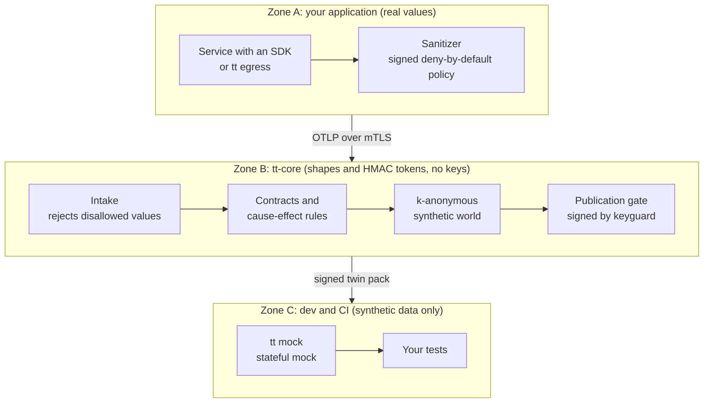

<div align="center">


# traffic-twin

**Stateful API mocks and contracts learned from production HTTP traffic, without exporting real data.**

[](https://github.com/ivseb/traffic-twin/actions/workflows/ci.yml)
[](https://github.com/ivseb/traffic-twin/releases)
[](LICENSE)
[](https://pkg.go.dev/github.com/ivseb/traffic-twin)
[](https://goreportcard.com/report/github.com/ivseb/traffic-twin)
[](https://ivseb.github.io/traffic-twin/)
[](RELEASING.md#3-controllare-la-bozza-e-pubblicarla)
<br>
[](https://www.npmjs.com/package/@traffic-twin/sdk)
[](https://pypi.org/project/traffic-twin/)
[](https://www.nuget.org/packages/TrafficTwin.Sdk)
[](https://central.sonatype.com/artifact/io.github.ivseb.traffictwin/sdk)
[](https://github.com/ivseb/traffic-twin/pkgs/container/traffic-twin)

[Documentation](https://ivseb.github.io/traffic-twin/) ·
[Getting started](https://ivseb.github.io/traffic-twin/guide/getting-started) ·
[Architecture](https://ivseb.github.io/traffic-twin/guide/architecture) ·
[Security model](https://ivseb.github.io/traffic-twin/guide/security) ·
[SDKs](https://ivseb.github.io/traffic-twin/guide/sdks) ·
[Changelog](CHANGELOG.md) ·
[Italiano](https://ivseb.github.io/traffic-twin/it/)

</div>

traffic-twin watches the HTTP traffic of an application in production, infers
**OpenAPI contracts** and **cause → effect rules** from it, and builds a
**stateful mock** for your tests, populated with consistent **synthetic
customers**. Values are sanitized inside the application process under a
deny-by-default policy, so only shapes, keyed HMAC tokens and the values a
signed policy explicitly allows leave it; every artifact passes a publication
gate before it reaches development or CI. It is open source (Apache-2.0)
and self-hosted.

> **Status: first public release (v0.1.0).** The whole pipeline runs end to
> end, but formats, APIs and SDK options may still change before 1.0. Read the
> [known limits](CHANGELOG.md#known-limits) and the
> [production security checklist](https://ivseb.github.io/traffic-twin/guide/operations#production-security-checklist)
> before you point it at real traffic.

> **Using a console your platform team already installed?** You do not need
> this README: the [user manual](docs/USER_GUIDE.md) (Italian, also in the
> console under *Aiuto > Manuale utente*) covers connecting your service,
> approving the policy and running `tt mock` in your tests.

## Why traffic-twin

Mocks written by hand, or recorded once, drift away from how the real service
behaves, and they rarely keep state across calls. The obvious fix, copying
production traffic or data into test environments, is a privacy and compliance
risk. traffic-twin learns from production while keeping real values where they
already are:

- **Real values stay in the process by default.** An SDK or the `tt egress` proxy applies
  a signed, deny-by-default policy before anything is sent: by default only the
  shape of a field leaves (`"drop:str:email"`), otherwise a keyed HMAC token, a
  bucket or a declared low-cardinality value.
- **Behaviour, not just schemas.** Contracts carry status codes, error rates and
  latencies; the rule miner finds what a call causes (an order creates a
  shipment that moves through its states). People review every rule.
- **Synthetic data that follows the rules.** Users become archetypes
  of at least *k* people (k = 20 by default); synthetic customers with invented
  data live forward in time under the approved rules. Same seed, same world.
- **A check at every boundary.** The intake rejects any value the policy does
  not allow; the publication gate looks for copies of real values, PII and
  small groups; keyguard signs the pack and the mock refuses unsigned packs.
- **Stated limits.** The [security model](https://ivseb.github.io/traffic-twin/guide/security#what-is-not-guaranteed)
  lists what is *not* guaranteed, and the [threat model](docs/THREAT_MODEL.md)
  documents each accepted risk.

## How it works

Data gets less sensitive as it moves away from the application, and every zone
boundary has a check. Real values exist only in zone A, for the duration of one
call.



1. **Observe.** A native SDK hooks the inbound handler and the outbound HTTP
   client before TLS; for stacks without an SDK, `tt egress` is an outbound
   reverse proxy with the same sanitizer.
2. **Sanitize.** The signed policy decides what may leave. Events travel as
   OTLP/HTTP JSON over mTLS to the intake of tt-core.
3. **Infer.** tt-core builds OpenAPI 3.1 contracts and mines cause → effect
   rules from tokens and shapes, never from values.
4. **Synthesize.** Archetypes of at least *k* users and the approved rules
   generate a deterministic synthetic world.
5. **Mock.** The publication gate checks the artifacts, keyguard (the only key
   holder, a separate process) signs the twin pack, and `tt mock` serves it in
   local tests and CI.

More in the [architecture overview](https://ivseb.github.io/traffic-twin/guide/architecture).

## Features

**Capture**
- Native SDKs for Go, Node.js, Python, Java, .NET and PHP with no runtime
  dependencies beyond the standard library; most start without code changes.
- `tt egress` (outbound reverse proxy), an optional OBI (eBPF) adapter, and a
  Kubernetes injector webhook for annotated pods.
- Sanitizer actions `drop`, `keep`, `hmac`, `bucket`, `code`, `code(alnum)` and
  `graphql`, covering JSON, GraphQL, XML/SOAP, multipart, base64 documents and
  large bodies. 827 conformance vectors keep the six SDKs byte-for-byte equivalent.
- Fail-closed sources: no valid signed policy, no key or no heartbeat means no
  capture, and the app keeps working. Under pressure events are dropped, never requests.

**Inference**
- Observed OpenAPI 3.1 contracts with `x-tt-*` extensions; contract drift
  raises webhook alerts.
- Rules for creations, updates, toggles, removals, keyed state, conditional
  outcomes, aggregates, lists, preconditions, GraphQL and SOAP operations,
  reviewed as drafts before use.

**Synthetic data and mock**
- k-anonymous synthetic customers and entities with the service's own id
  formats, valid synthetic documents and relative dates.
- `tt mock`: per-test sessions, a virtual clock, faults at the observed rates,
  a control API and a call journal, for REST, GraphQL, SOAP/XML, an
  S3-compatible API and third-party pages with callbacks.
- Runs as a binary, a container or a Helm chart, or is started from the
  console on Kubernetes/OpenShift. `tt export` converts a pack to WireMock,
  Microcks or Prism, with a report of what each format loses.

**Security and supply chain**
- Three trust zones; keyguard is the only holder of the HMAC and signing keys.
- Policies that open values need two people, or an administrator with a
  recorded reason and an alert; OIDC step-up approvals verified by keyguard;
  hash-chained audit log.
- Publication gate: string provenance, reverse HMAC check for exact copies of
  real values, PII detectors and *k* thresholds; Ed25519-signed packs.
- No outbound calls from tt-core or keyguard except allow-listed webhooks.
- Static binaries, a multi-arch image, SPDX SBOMs, cosign keyless signatures
  and SLSA level 3 provenance.

**Console**
- Guided onboarding with ready-made commands, a policy assistant that proposes
  an action per field from shapes and counts, contract diffs, rule review,
  worlds and packs.
- Per-page and per-field help, a glossary and the user manual built in. The
  console and the detailed reference documentation are in Italian; the
  [guides on the documentation site](https://ivseb.github.io/traffic-twin/) are in English.

## Quickstart (single host)

Requirements: Go 1.25+, Node.js 24+ for the demo (the Node SDK itself needs
Node ≥ 20; full `fetch` body capture needs Node ≥ 24), make, curl, jq, openssl.

```sh
git clone https://github.com/ivseb/traffic-twin.git && cd traffic-twin
make build
./bin/tt dev up            # keyguard (Unix socket) + tt-core, keys generated in ./tt-dev
```

`tt dev up` prints the UI URL (`https://127.0.0.1:7070`, self-signed loopback
certificate), the intake URL for sources (`https://localhost:4318`), the HMAC
key file the sources need, the keyguard socket and a one-time **setup token**:
open the UI and create the first administrator with it. Everything stays on
loopback; it is a trial layout, not a production one (keyguard shares the
host). `.gitignore` already covers `tt-dev/`.

Then create a source group in the onboarding wizard (it gives an enrollment
token), start a source (an SDK or `tt egress`), approve a policy, and follow
contracts → rules → world → signed pack. Things worth knowing:

- the starter policy of the wizard only discovers shapes; the demo ships its
  own, [`demo/policy.yaml`](demo/policy.yaml), proposed through the admin API
  ([`api/admin-api.v1.openapi.yaml`](api/admin-api.v1.openapi.yaml));
- the rule miner wants at least one hour of captured traffic by default. For
  the accelerated demo clock use `tt dev up -miner-horizon 5m` (config key
  `miner.min_horizon` in `tt core`); never lower it on real traffic.

The [getting started guide](https://ivseb.github.io/traffic-twin/guide/getting-started)
is a 15-minute tour: the demo shop, the Node SDK, an approved policy, rules,
a signed pack and a mock answering the demo flow.

**The whole product in a few seconds:**

```sh
go test ./internal/core -run TestProductEndToEnd -v
```

It starts keyguard and tt-core, enrolls a source, sends a simulated week of
the [demo shop](demo/) over mTLS, mines the rules, builds and publishes a
pack, runs it in the mock and exports it.

### Use the mock in your tests

`tt mock` trusts only the gate's public keys (`TT_GATE_PUBKEYS`; in the console,
*Pacchetti twin > Come usarlo nei test*) and needs a `TT_CONTROL_TOKEN`:

```sh
export TT_GATE_PUBKEYS='pack-dev-1:<public_key>'
export TT_CONTROL_TOKEN="$(openssl rand -hex 24)"      # always, locally and in CI
./bin/tt mock --pack ~/Downloads/<pack_id>.ttpack --addr 127.0.0.1:8480 --latency record &

AUTH="Authorization: Bearer $TT_CONTROL_TOKEN"
SID=$(curl -s -H "$AUTH" -X POST localhost:8480/__tt/sessions -d '{}' | jq -r .id)

# the service under test calls http://127.0.0.1:8480/__svc/<service>/... with X-TT-Session: $SID
# the clock is virtual: advance it and the rules move state forward
curl -s -H "$AUTH" -X POST localhost:8480/__tt/sessions/$SID/clock/advance -d '{"by":"5m"}'
```

State is per session, so one test's writes are visible only to it. A CI job
does not need tt-core at all: it fetches `tt` and the signed pack, starts the
mock and points the external service's base URL at it. `tt mock -h` prints
every option with an example; the [mock section of the guide](https://ivseb.github.io/traffic-twin/guide/getting-started#6-the-mock-locally-and-in-ci)
has a GitHub Actions step.

## SDKs

| Language | Install | Minimum runtime | Docs |
|---|---|---|---|
| Go | `go get github.com/ivseb/traffic-twin/sdk/go` | Go 1.25 | [sdk/go](sdk/go/README.md) |
| Node.js | `npm i @traffic-twin/sdk` | Node 20 (full `fetch` bodies from 24) | [sdk/node](sdk/node/README.md) |
| Python | `pip install traffic-twin` | Python 3.9 | [sdk/python](sdk/python/README.md) |
| Java | Maven `io.github.ivseb.traffictwin:sdk:0.1.0` (also `sdk-servlet-javax`, `sdk-otel-extension`, `sdk-agent`); Gradle `implementation("io.github.ivseb.traffictwin:sdk:0.1.0")` | Java 17 | [sdk/java](sdk/java/README.md) |
| .NET | `dotnet add package TrafficTwin.Sdk` (and `TrafficTwin.Sdk.AspNetCore`) | .NET 8 | [sdk/dotnet](sdk/dotnet/README.md) |
| PHP | from source: [`sdk/php`](sdk/php) as a Composer `path` repository (`traffic-twin/sdk`, not on Packagist yet) | PHP 8.1 with ext-sodium | [sdk/php](sdk/php/README.md) |

Every SDK reads the same `TT_*` environment variables and passes the same
conformance vectors. The SDK READMEs are in Italian; the
[SDK guide](https://ivseb.github.io/traffic-twin/guide/sdks) summarizes them in
English. For a given outbound call use either an SDK or `tt egress`, never
both: Fleet flags `double_capture`.

## Install

- **Binaries:** static `tt` archives for linux, darwin and windows × amd64/arm64
  on [GitHub Releases](https://github.com/ivseb/traffic-twin/releases).
- **Container image:** multi-arch `ghcr.io/ivseb/traffic-twin` (the default
  command is `core -config /etc/tt/core.yaml`):

  ```sh
  docker run --rm ghcr.io/ivseb/traffic-twin:0.1.0 version
  ```

- **Kubernetes:** Helm charts for `tt-core`, `tt-keyguard`, `tt-egress`,
  `tt-mock` and the SDK injector in [`deploy/helm/`](deploy/helm/); see
  [`deploy/README.md`](deploy/README.md).
- **From source:** `make build` (Go 1.25+), or `docker build -t traffic-twin .`
  and mount a configuration at `/etc/tt/core.yaml`.

**Verify the release.** `checksums.txt` is signed keyless with cosign, every
archive has an SPDX SBOM and SLSA level 3 provenance, and the image is signed
by digest:

```sh
cosign verify-blob --bundle checksums.txt.sigstore.json \
  --certificate-identity-regexp '^https://github.com/ivseb/traffic-twin/\.github/workflows/release\.yml@refs/tags/v' \
  --certificate-oidc-issuer https://token.actions.githubusercontent.com checksums.txt
slsa-verifier verify-artifact tt_0.1.0_linux_amd64.tar.gz --provenance-path multiple.intoto.jsonl \
  --source-uri github.com/ivseb/traffic-twin --source-tag v0.1.0
```

The full procedure, image included, is in [RELEASING.md](RELEASING.md#3-controllare-la-bozza-e-pubblicarla).

## Production layout

`tt core -config core.yaml` with `tt keyguard` on another host over mTLS: see
[`deploy/examples/`](deploy/examples/) (`core.production.yaml`,
`keyguard.production.env` and the single-host variants). `tt core init` writes
a starting configuration. Sources connect only to the intake (mTLS, Fleet CA
pinned by the enrollment token); keyguard accepts only tt-core.

- **Approvals with OIDC.** Let keyguard verify approvals through a dedicated
  "approval" client at your identity provider (`TT_KEYGUARD_OIDC_*`): each
  approval takes a step-up and keyguard reads the approver's roles from the
  token. Without OIDC the UI shows `approvals_unverified`, fit only for
  single-host and development installs.
- **First administrator.** The one-time setup token is written to
  `setup-token` in the data directory (mode 0600), never to the console or the
  log: read it on the host, create the administrator, delete the file.
- **Administrators are traced, not limited.** The `admin` role implies every
  other role; overrides are recorded in the hash-chained audit log and raise
  alerts. `TT_KEYGUARD_ADMIN_OVERRIDE=false` stops admins from approving or
  releasing alone.
- **One tt-core per keyguard (v1).** Keyguard refuses a policy sequence that is
  not greater than the last one, so a second core gets `409 keyguard_state_conflict`.

Sizing, backups, monitoring and the security checklist are in the
[operations summary](https://ivseb.github.io/traffic-twin/guide/operations)
and the full [operations guide](docs/OPERATIONS.md).

## Commands

| Command | What it does |
|---|---|
| `tt core` | zone-B server: intake, Fleet, contracts, drift, rules, worlds, gate, admin API and UI |
| `tt core init` | writes a configuration and the data directory |
| `tt dev up` | single-host trial: keyguard + core in one process |
| `tt keyguard` | key custodian: reverse-HMAC, policy and pack signing (`genkey`, `pin`) |
| `tt egress` | outbound reverse proxy that captures for stacks without an SDK |
| `tt mock` | serves a signed pack as a stateful mock |
| `tt export` | converts a pack to WireMock / Microcks / Prism |

## Repository layout

| Path | Content |
|---|---|
| `cmd/tt` | the single `tt` binary |
| `internal/core` | composition root of tt-core (wiring, admin API glue, acceptance test) |
| `internal/` | the components (sanitizer, policy, fleet, intake, store, contract, drift, miner, world, gate, mock, ...) |
| `sdk/` | the six capture SDKs |
| `conformance/` | the sanitizer conformance vectors shared by every SDK |
| `ui/` | review UI (Svelte + Vite), embedded into `tt` |
| `api/`, `schemas/`, `docs/spec/` | the contracts |
| `deploy/` | example configurations and Helm charts |
| `demo/` | an invented e-commerce shop and carrier with a known ground truth |

`make test` runs the Go tests (the acceptance test included, about 4 s;
`go test -race ./...` also passes, about 40 s for it).

## Documentation

- English guides: [getting started](https://ivseb.github.io/traffic-twin/guide/getting-started),
  [architecture](https://ivseb.github.io/traffic-twin/guide/architecture),
  [security model](https://ivseb.github.io/traffic-twin/guide/security),
  [SDKs](https://ivseb.github.io/traffic-twin/guide/sdks),
  [operations](https://ivseb.github.io/traffic-twin/guide/operations).
- Full reference (Italian), in [`docs/`](docs/) and on the
  [site](https://ivseb.github.io/traffic-twin/it/): [architecture](docs/ARCHITECTURE.md),
  [threat model](docs/THREAT_MODEL.md), [operations](docs/OPERATIONS.md),
  [data lifecycle](docs/DATA_LIFECYCLE.md), [performance](docs/PERFORMANCE.md),
  [user manual](docs/USER_GUIDE.md) and the normative [specifications](docs/spec/README.md).

## Contributing, security and license

- **Contributing:** see [CONTRIBUTING.md](CONTRIBUTING.md). traffic-twin is a
  clean-room implementation: read the clean-room rule before you contribute.
- **Security:** report vulnerabilities privately as described in
  [SECURITY.md](SECURITY.md), never in a public issue.
- **License:** [Apache License 2.0](LICENSE); see also [NOTICE](NOTICE).
