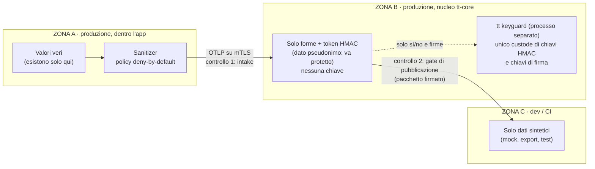
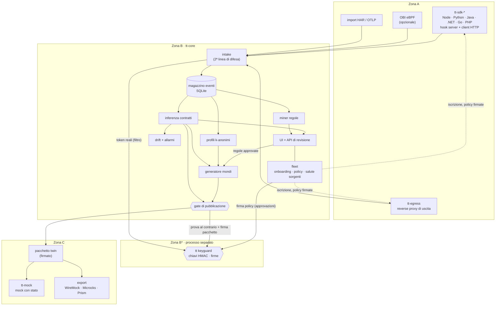
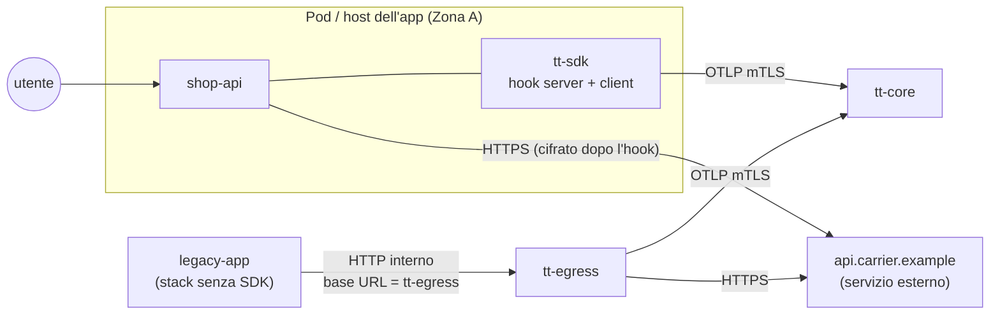
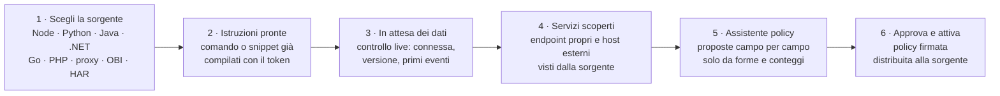
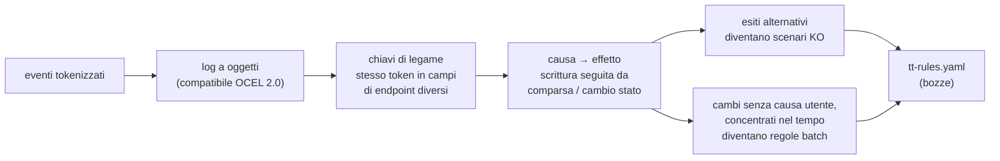
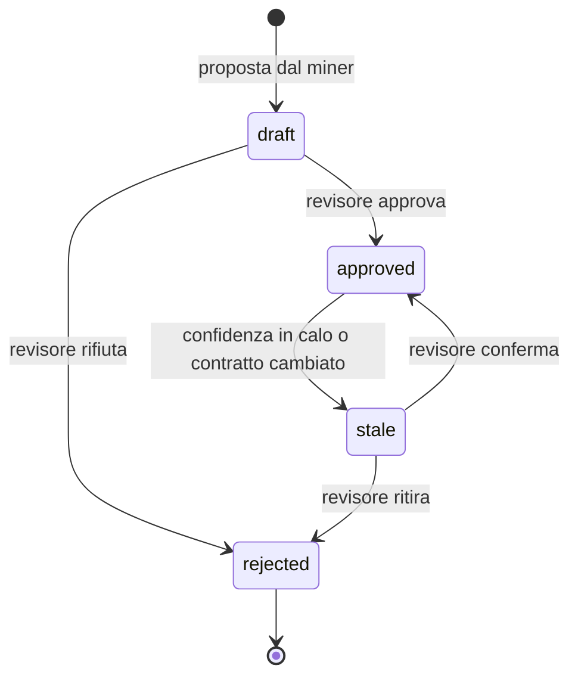
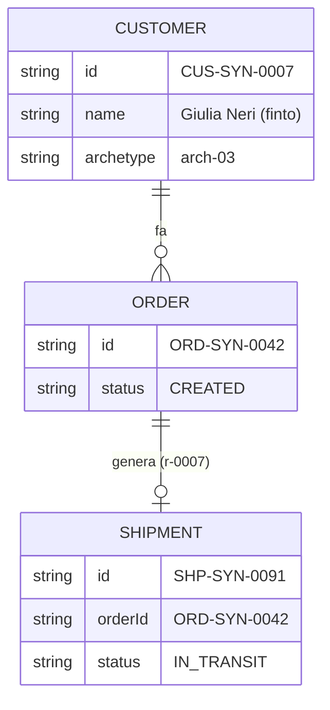
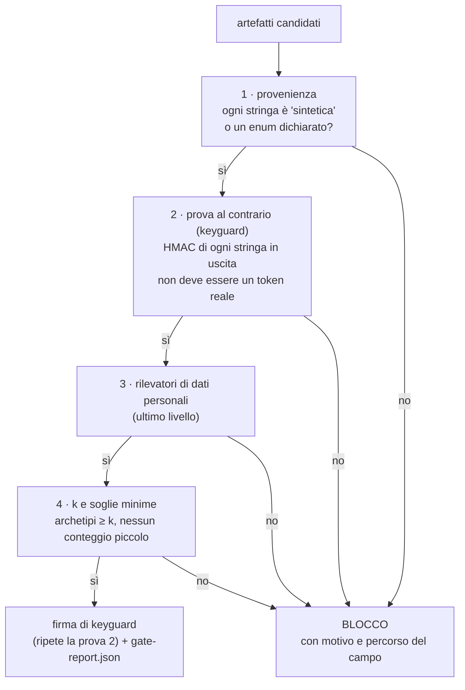
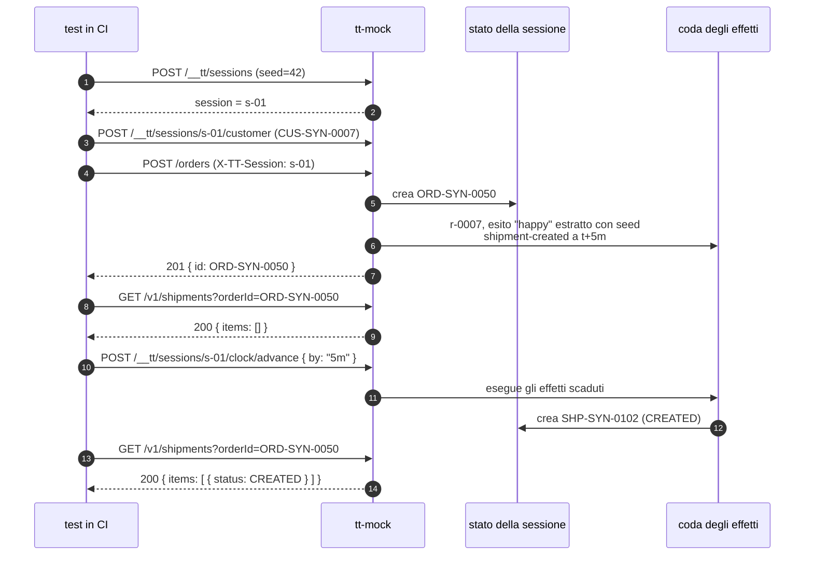
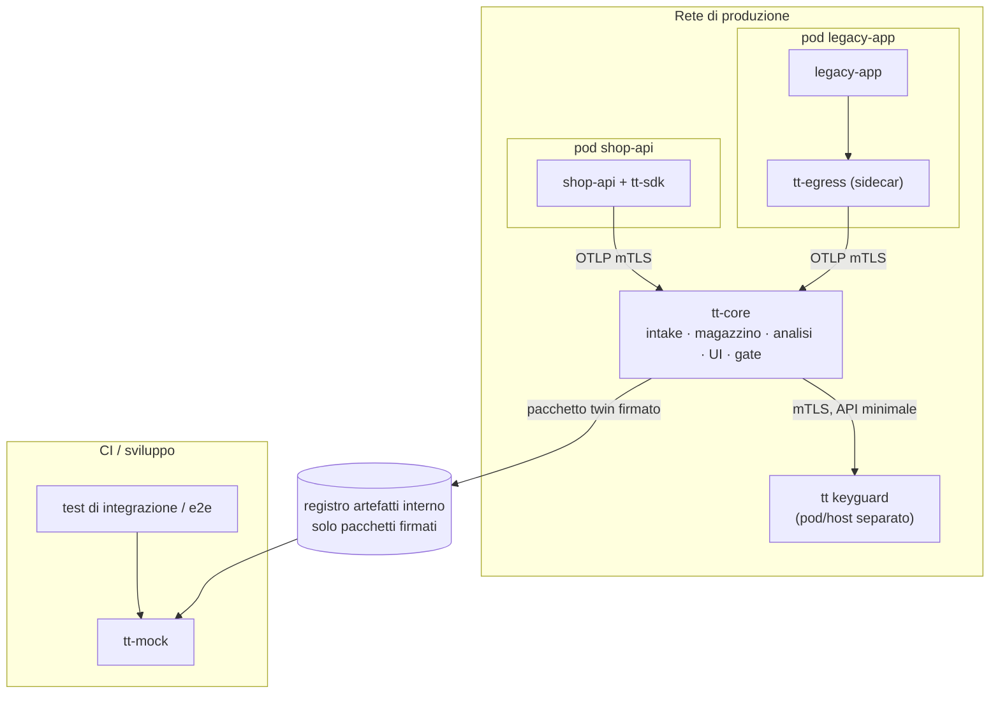

# traffic-twin — Architettura

> Stato: revisione 1.1, allineata alle specifiche v1.1 (ottobre 2026).
> Tutti gli esempi sono inventati (un e-commerce con un corriere esterno). Nessun riferimento a clienti, host o dati reali.
>
> I formati **normativi** sono in [docs/spec/](spec/README.md); il threat model in [THREAT_MODEL.md](THREAT_MODEL.md). In caso di differenza fanno fede le specifiche: gli esempi qui sono semplificati.

## 0. In una frase

traffic-twin osserva il traffico HTTP di un'app in produzione **senza mai portare fuori i valori veri**, ne ricava **contratti** e **regole causa → effetto**, e produce un **mock con stato** da usare nei test, popolato da **clienti sintetici** coerenti.

## 1. Le tre zone di fiducia

Tutta l'architettura si regge su una regola: i dati diventano sempre meno sensibili man mano che si allontanano dall'app, e ogni passaggio di zona ha un controllo.



| Zona | Dove gira | Cosa contiene | Chi ci accede |
|---|---|---|---|
| A | Dentro i processi dell'app, o nel proxy di uscita accanto | Richieste e risposte vere, per il tempo di una chiamata | Nessuno: tt non salva nulla qui |
| B | `tt-core`, installato nella rete di produzione | Eventi tokenizzati, contratti, regole in bozza, archetipi. **Nessuna chiave** | Pochi ruoli (7 ruoli, vedi API di amministrazione), con audit |
| B* | `tt keyguard`, processo separato ([keyguard.md](spec/keyguard.md)) | Chiavi HMAC, chiavi di firma di policy e pacchetti | Solo `tt-core`, tramite un'API minimale |
| C | Laptop, CI, ambienti di test | Pacchetti twin firmati, mock, export WireMock/Microcks/Prism | Tutti gli sviluppatori |

## 2. Componenti



| Componente | Zona | Responsabilità | Input → output |
|---|---|---|---|
| `tt-sdk-*` | A | Cattura chiamate in ingresso e in uscita **prima della cifratura**, sanifica, campiona per utente | Richiesta/risposta HTTP → evento `tt.http.exchange` |
| `tt-egress` | A | Reverse proxy per gli stack senza SDK; stessa sanificazione | Traffico HTTP → evento `tt.http.exchange` |
| OBI | A | Cattura eBPF opzionale, con la lista bianca nativa di OBI | Span OTLP → evento (tramite adattatore) |
| intake | B | Riceve OTLP, verifica hash della policy, **scarta** ogni evento con valori non ammessi | OTLP → righe nel magazzino |
| magazzino | B | Eventi tokenizzati, conservazione limitata (es. 30 giorni); statistiche dei contratti aggiornate all'arrivo degli eventi | SQLite (driver Go puro) |
| inferenza contratti | B | Schemi, presenza dei campi, status, errori, latenze, template dei path | Eventi → OpenAPI 3.1 + `x-tt-*` |
| miner regole | B | Chiavi di legame, causa → effetto, esiti alternativi, batch | Eventi → `tt-rules.yaml` (bozze) |
| profili | B | Raggruppa gli utenti in archetipi con almeno *k* persone | Eventi → `archetypes.json` |
| generatore mondi | B | Crea clienti sintetici e la loro storia applicando le regole approvate | Contratti + regole + archetipi + seed → mondo |
| gate | B→C | Controlli automatici che bloccano la pubblicazione se trovano dati reali; la prova al contrario e la firma le fa keyguard | Artefatti → pacchetto firmato oppure rifiuto motivato |
| `tt keyguard` | B* | Unico custode delle chiavi in zona B: prova al contrario HMAC (solo sì/no), firma delle policy dopo aver ricontrollato le approvazioni, firma dei pacchetti | API interna su socket Unix o mTLS |
| drift | B | Confronta fotografie dei contratti nel tempo, manda allarmi | Contratti → allarmi webhook |
| fleet | B | Onboarding guidato delle sorgenti, iscrizione con token, distribuzione delle policy firmate, stato di salute di ogni sorgente | Token di iscrizione → certificato mTLS + policy |
| UI | B | Onboarding, revisione/approvazione regole, contratti e differenze, buchi, scenari | — |
| `tt-mock` | C | Mock con stato, orologio virtuale, guasti, API di controllo, registro chiamate | Pacchetto twin → server HTTP |
| exporter | C | Conversione verso altri strumenti, con report di cosa si perde | Pacchetto twin → file WireMock/Microcks/Prism |

### 2.1 Scelte tecnologiche (decise)

- **Go** per `tt-egress`, `tt-core`, `tt-mock` ed exporter: un solo binario statico `tt` con sottocomandi, modulo `github.com/ivseb/traffic-twin`, facile da installare in casa.
- **SQLite** con driver Go puro (niente cgo): un file, nessun server. Le statistiche dei contratti si aggiornano mentre gli eventi arrivano, quindi non serve un motore analitico. ClickHouse o Postgres restano un'opzione per volumi grandi (fase 4).
- **Svelte + Vite** per la UI, compilata in file statici e inclusa nel binario.
- **SDK nativi per linguaggio, senza dipendenze**: solo la libreria standard. Parlano OTLP/HTTP in JSON scritto a mano (nessun pacchetto OpenTelemetry) e ricevono la policy già compilata in JSON (nessun parser YAML). L'uguaglianza tra linguaggi si garantisce con i vettori di conformità (§4.3).

## 3. Cattura

### 3.1 Da dove arriva il traffico



Il TLS verso i servizi esterni si gestisce così, in ordine di preferenza:

1. **SDK nel processo, anche per le chiamate in uscita.** L'hook sta sul client HTTP (`undici`/`http` in Node, `httpx`/`requests` in Python, `HttpClient` in .NET, `RoundTripper` in Go, Guzzle in PHP, client Java). Vede i dati **prima della cifratura**, quindi il TLS non è un problema. È la strada principale.
2. **Reverse proxy di uscita** per gli stack senza SDK. Si cambia la base URL del servizio esterno, di solito una variabile d'ambiente: l'app chiama `http://tt-egress/shipping/...`, il proxy prosegue in TLS. Niente certificati, niente modifiche al codice.
3. **OBI (eBPF)**, opzionale: aggancia le librerie TLS senza toccare l'app. Limiti: solo Linux (host privilegiato o VM, non un LXC non privilegiato), solo body JSON, pochi KB. **La copertura del TLS in uscita dipende dallo stack**: OBI aggancia le librerie TLS che conosce (per esempio OpenSSL e il `crypto/tls` di Go), quindi runtime, versione e modo di collegare la libreria cambiano ciò che si vede; va verificata sullo stack reale prima di contarci, e dove manca si torna a SDK o `tt-egress`.
4. **Proxy con CA interna (MITM): mai di default.** Funziona senza cambiare le URL, ma l'app deve fidarsi di una CA che può leggere tutto il traffico cifrato e il certificate pinning si rompe. Resta un'opzione esplicita, segnalata nel threat model.

### 3.2 Convivenza con OpenTelemetry

- L'SDK **non registra mai** un `TracerProvider` globale, né un propagatore globale.
- Se l'app ha già OpenTelemetry, l'SDK **legge** `traceparent` e baggage dal contesto corrente e li usa per collegare le chiamate in uscita a quella in ingresso.
- L'esportazione usa un exporter OTLP **privato** verso `tt-core`, separato da quello dell'app.
- Si usano i punti di estensione nativi invece di sostituire funzioni a runtime: `diagnostics_channel` in Node, middleware ASGI/WSGI in Python, `DelegatingHandler`/`DiagnosticListener` in .NET, `http.Handler`/`RoundTripper` in Go, PSR-15 in PHP. In Java c'è un'estensione dell'agent OpenTelemetry se l'agent è presente, altrimenti un filtro servlet.

### 3.3 Campionamento per utente

Per correlare serve la storia intera di un utente, quindi si campiona per utente e non per richiesta:

```
campionato(utente) = HMAC(chiave, epoch ‖ "sample" ‖ utente) mod 10000 < rate_bp
```

- La decisione è **stabile per tutta l'epoch**: lo stesso utente è sempre dentro o sempre fuori, in tutti i servizi e in tutte le sessioni; cambia solo quando cambia l'epoch.
- Le chiamate in uscita **ereditano** la decisione della richiesta in ingresso che il processo sta servendo.
- Per default tt non tocca il traffico: il membro di baggage `tt.s` si aggiunge solo verso gli host interni elencati in `sampling.propagate_to`, mai verso servizi esterni, e si considera solo su servizi dichiarati interni (`match.internal`), così un client esterno non può forzare né evitare la cattura (sanitizer §12).
- Sotto pressione l'SDK **scarta eventi interi, mai la richiesta**: l'app non viene mai bloccata né rallentata in attesa di tt.

### 3.4 Onboarding delle sorgenti (stile Fleet/APM)

Obiettivo: aggiungere una sorgente deve essere **plug & play**, guidato dalla UI, come "Add integration" in Kibana Fleet o la pagina di setup dell'APM. Nessun file da scrivere a mano per partire.

#### Il percorso guidato



1. **Scegli la sorgente.** Schede per linguaggio e modalità, con i requisiti in chiaro (versione del runtime, framework supportati, se serve cambiare una base URL).
2. **Istruzioni pronte.** La UI genera tutto ciò che serve, già compilato con un **token di iscrizione** (monouso e a scadenza, oppure di gruppo e revocabile per i deployment replicati). Il token contiene l'impronta della CA di `tt-core`, così la sorgente si fida del server senza altra configurazione:

   ```bash
   # Node
   npm install @traffic-twin/sdk
   TT_ENROLL_URL=https://tt-core.internal:4318 TT_ENROLL_TOKEN=tte_9f…  node --import @traffic-twin/sdk/register app.js
   ```

   ```bash
   # proxy di uscita in Kubernetes
   helm install tt-egress traffic-twin/egress --set enroll.url=https://tt-core.internal:4318 --set enroll.token=tte_9f…
   ```

   Per Kubernetes c'è anche un'**annotazione** sul deployment (`traffic-twin.io/inject: node`): un webhook aggiunge l'SDK al pod, sulla stessa idea dell'iniezione dell'operatore OpenTelemetry, senza conflitti con essa.
3. **In attesa dei dati.** La pagina resta aperta e si aggiorna da sola: "connessa", "policy ricevuta", "primi 20 eventi arrivati". Se qualcosa non va, dice cosa e come risolverlo (token scaduto, certificato rifiutato, nessun utente riconosciuto nell'header indicato).
4. **Servizi scoperti.** Dagli eventi arrivano in automatico:
   - i servizi propri (nome proposto da `OTEL_SERVICE_NAME`, poi fissato all'iscrizione e legato al gruppo);
   - gli **host esterni** chiamati, sempre (v1.5, `hosts.discovery: auto` di default), raggruppati per dominio registrabile nel **registro degli host** (`GET /api/v1/hosts`: pattern, chiamate, servizi chiamanti, prima e ultima volta, tasso d'errore, latenza mediana). Un host esce come **pattern** (sanitizer §3.5): le etichette che sembrano valori (sei cifre consecutive, dodici esadecimali consecutivi, formati di valore, fuori da `^[a-z][a-z0-9-]{0,62}$`) diventano `{*}`, gli IP solo `ip:private` / `ip:public`; l'intake ricontrolla la regola e collassa in `{*}` una posizione con più di 50 etichette distinte sotto lo stesso dominio registrabile (quarantena `host_cardinality`). Da lì un host si propone come "servizio esterno da gemellare" (`POST /api/v1/hosts/{pattern}/twin`: una **bozza** di policy con `match.base`, che segue le approvazioni normali; per un pattern con `{*}` la persona scrive l'host esatto, che deve corrispondere al pattern). Chi non vuole che esca nessun host non dichiarato imposta la modalità stretta `hosts.discovery: off` (host non dichiarati → `host:unlisted`).
5. **Assistente policy.** Parte dalla policy più chiusa (tutto `drop`). Per ogni campo visto mostra **solo la forma e i conteggi** (mai valori) e propone un'azione:

   | Campo | Forma osservata | Valori distinti (contati sui token) | Proposta |
   |---|---|---|---|
   | `$.id` | stringa, 16 caratteri, alta entropia | 4.120 su 4.120 | `hmac` (identificatore) |
   | `$.status` | stringa maiuscola | 5 | `keep` (enum) |
   | `$.total` | numero | 3.870 | `bucket` |
   | `$.email` | stringa, formato email | 1.290 | resta `drop` |

   Le proposte nascono da forme e cardinalità calcolate sui token in zona B. Un umano conferma.

   L'assistente lavora per **operazione**: i path grezzi della scoperta (`GET /orders/{drop:str:l32}`) diventano template (`GET /orders/{id}`): un segmento che è una forma è un parametro, e lo è anche una posizione con più di 10 parole distinte (parole che in realtà sono valori). La route del framework non esce dalla sorgente se la policy non la dichiara, quindi conta la cardinalità dei segmenti. Se un'operazione ha meno di 20 chiamate, l'assistente dice quante ne servono ancora. Per gli host esterni la persona sceglie nome del servizio e schema (`http`/`https`: gli eventi non lo portano, non si indovina); propone anche **chi è l'utente** (`identity.subject`, per esempio header `authorization` con claim `sub`). Le scelte (azioni, mai valori) vanno a tt-core, che le scrive nella policy attiva e crea la bozza da approvare (`POST /api/v1/fleet/policies/{id}/assist/draft`): nessun YAML da scrivere a mano.
6. **Approva e attiva.** La policy viene firmata da `tt keyguard` e distribuita. Ogni modifica che non sia di sola chiusura (compresa la prima policy, che attiva scoperta e parole automatiche per 72 ore) richiede **due persone diverse**; keyguard lo ricontrolla prima di firmare.

#### Policy gestite centralmente

- Come le "agent policy" di Fleet: le sorgenti **scaricano** la policy da `tt-core` su mTLS, la tengono in cache e la riscaricano a intervalli.
- Ogni policy è **firmata, versionata, legata ai gruppi di destinazione e con una scadenza**. Una sorgente rifiuta le policy non firmate, scadute, di un altro gruppo o più vecchie di quelle già viste. Se non raggiunge `tt-core` usa l'ultima policy valida fino alla sua scadenza, poi **smette di catturare**: non passa mai a una policy più aperta.
- Una policy si assegna a un gruppo di sorgenti (per esempio "tutti i pod di shop-api").
- Prima di catturare qualsiasi cosa, la sorgente manda un heartbeat: così riceve subito lo stato dell'interruttore di emergenza, che salva anche nella cache.

#### Isolamento tra gruppi (console condivisa)

- Il **gruppo di un evento è il gruppo della sorgente** che l'ha catturato (`fleet_sources.grp`, copiato in `fleet_source_groups`, che resta quando la retention cancella la sorgente: gli eventi restano attribuiti).
- L'**identità di un servizio osservato è (gruppo, servizio)**. Due team che chiamano lo stesso `127.0.0.1:9301` producono entrambi `host:ip:private:9301`, ma sono due servizi: righe, chiamate, host, contratti (le fotografie hanno la colonna `grp`), mondi e pacchetti separati. Un nome dichiarato nella policy di un gruppo non rinomina né fonde il traffico di un altro gruppo (`now_declared_as` si calcola solo con le policy del gruppo).
- Ogni lista dell'API di amministrazione accetta `?group=` (ripetuto o separato da virgole; senza: tutti i gruppi, ogni riga con il suo `group`): servizi, host, policy, contratti, buchi, allarmi, quarantena, archetipi, mondi, pacchetti, regole e stato del miner. Le regole sono attribuite ai gruppi attraverso i loro servizi (i gruppi che hanno prodotto **ogni** servizio che toccano).
- Il miner analizza il traffico di ogni gruppo separatamente: un'entità è l'oggetto che un servizio crea in un dominio dentro un gruppo, e due team che creano un `order` hanno due entità (`order` e `order-orders-api`, nomi stabili tra le esecuzioni, [rules.md](spec/rules.md) §2.7). Un mondo di un gruppo le cui regole approvate non si possono usare si rifiuta (`no_usable_rules`) invece di uscire vuoto.
- Un mondo si genera per un gruppo (contratti dal solo traffico del gruppo, archetipi del gruppo, regole del gruppo); il pacchetto prende il gruppo del mondo e il gate rifiuta (`mixed_groups`) una selezione di servizi di più gruppi, salvo scelta esplicita di un amministratore (`multi_group`).

#### Stato delle sorgenti

Una pagina con tutte le sorgenti iscritte, come la lista degli agent di Fleet:

| Sorgente | Tipo | Versione | Policy | Ultimo contatto | Eventi/min | Scartati | Overhead stimato |
|---|---|---|---|---|---|---|---|
| shop-api (3 pod) | sdk-node 0.4.1 | aggiornata | p-shop v7 | 12 s fa | 1.840 | 0,2% | +1,1 ms p50 |
| legacy-app | egress 0.4.0 | aggiornabile | p-legacy v2 | 8 s fa | 310 | 0 | — |

Da qui si può: revocare una sorgente, sospendere la cattura con un clic (interruttore di emergenza), cambiare il tasso di campionamento, vedere gli errori recenti della sorgente.

## 4. Il sanitizer

### 4.1 Cosa fa

Percorre ogni parte della chiamata (path, query, header, body) e applica la policy. **Il default è `drop`**: del campo resta solo la *forma*.

| Azione | Cosa esce | Esempio in ingresso | Esempio in uscita |
|---|---|---|---|
| `drop` (default) | Tipo, classe di lunghezza, formato riconosciuto | `"mario.rossi@example.com"` | `"drop:str:email"` |
| `keep` | Il valore, solo per campi a bassa cardinalità dichiarati | `"CREATED"` | `"keep:CREATED"` |
| `hmac` | Token stabile, uguale per valori uguali | `"ORD-2026-000184"` | `"tk1:k1:Zx81…"` |
| `bucket` | Valore generalizzato in fasce | `73.40` | `"num:50-100"` |

Casi particolari, sempre trattati dentro il processo:

- **Segmenti di path**: `/customers/mario@x.it/orders` diventa `/customers/{drop:str:email}/orders`, oppure `/customers/{tk1:k1:…}/orders` se la policy dichiara il parametro come `hmac`. Il template `{id}` si ricava dopo, in zona B, dalla cardinalità.
- **Chiavi e nomi dinamici**: chiavi JSON, nomi di query, cookie e header che sembrano ID, email o contengono sei o più cifre di fila collassano in `{*}`; l'intake mette in quarantena i nomi con troppi valori distinti.
- **Body non JSON** (XML, testo, multipart) o con compressione non supportata: esce solo tipo e dimensione.
- **Header e cookie**: i valori sono tutti `drop`, salvo le regole esplicite della policy (tipicamente `content-type`); non c'è una lista bianca predefinita.
- **Forme**: le classi di lunghezza sono solo cinque (`l8`, `l32`, `l128`, `l1024`, `lmax`), per rivelare il meno possibile.

### 4.2 La policy

```yaml
# tt-policy.yaml — tutto ciò che non è elencato è "drop" (formato completo: docs/spec/policy.md)
format: tt.policy/v1
policy_id: p-shop
default: drop

hmac:
  kid: k1                         # la chiave vera è locale alle sorgenti (TT_HMAC_KEY), mai nel file
  epoch: "2026-10"                # rotazione: token diversi per epoca

identity:
  subject: { from: header, name: authorization, jwt_claim: sub }   # chi è l'utente

sampling: { rate: 0.05 }          # per utente, deciso con HMAC

global:
  errors:                         # vale per tutte le risposte 4xx/5xx
    body:
      $.error.code: keep

services:
  shop-api:
    match: { inbound: true }
    ops:
      "POST /orders":
        response:
          $.id: hmac(order)
          $.status: keep
          $.total: bucket(num, [0, 50, 100, 250])
  shipping-ext:
    match: { base: "https://api.carrier.example" }
    ops:
      "GET /v1/shipments":
        response:
          $.items[*].orderId: hmac(order)
          $.items[*].shipmentId: hmac(shipment)
          $.items[*].status: keep
```

Lo stesso dominio HMAC (`order`) su campi diversi produce lo stesso token per lo stesso valore: è ciò che permette di scoprire le chiavi di legame.

La policy viene compilata in JSON, firmata con Ed25519 da keyguard e il suo **hash viaggia in ogni evento**. L'intake rifiuta gli eventi con un hash sconosciuto o non assegnato al gruppo della sorgente.

### 4.3 Vettori di conformità

Lo stesso sanitizer esiste in sei linguaggi, quindi serve una prova che si comporti allo stesso modo ovunque. Il formato normativo è in [conformance/format.md](../conformance/format.md):

```
conformance/
  vectors/
    0001-default-drop.json           # policy compilata, ingresso, uscita canonica attesa
    0002-hmac-equal-values.json
    …
  policies/                          # corpi di policy compilati condivisi
  ref/                               # generatore di riferimento indipendente (Python, solo stdlib)
```

Ogni SDK deve produrre `expected.canonical` **byte per byte** in CI, più test generativi: con una policy vuota, nessuna stringa dell'input deve comparire nell'output.

## 5. Formato degli eventi

Trasporto: **OTLP/HTTP JSON**, un log record per evento con `eventName = tt.http.exchange` e l'evento in JSON canonico nel corpo (formato completo: [docs/spec/event.md](spec/event.md)).

Esempio, lunedì 10:00:00. Un utente reale crea un ordine (estratto):

```json
{
  "schema": "tt.http.exchange/v1",
  "policy": { "id": "p-shop", "version": 7, "hash": "sha256:9c1e…" },
  "dir": "inbound",
  "service": "shop-api",
  "op": "POST /orders",
  "status": 201,
  "latency_ms": 184,
  "ts": "2026-10-19T10:00:00.412Z",
  "subject": "tk1:k1:7Hq2…",
  "trace_id": "4bf9…",
  "req": {
    "path": "/orders",
    "body": {
      "items": [ { "sku": "drop:str:l32", "qty": "drop:int" } ],
      "email": "drop:str:email",
      "note": "drop:str:l8"
    }
  },
  "resp": {
    "body": { "id": "tk1:k1:Zx81…", "status": "keep:CREATED", "total": "num:50-100" }
  }
}
```

Un secondo dopo, la chiamata in uscita al corriere, con lo stesso `trace_id` (estratto):

```json
{
  "dir": "outbound",
  "service": "shipping-ext",
  "op": "POST /v1/shipments",
  "status": 202,
  "trace_id": "4bf9…",
  "req":  { "path": "/v1/shipments", "body": { "orderId": "tk1:k1:Zx81…", "address": { "city": "drop:str:l8", "street": "drop:str:l32" } } },
  "resp": { "body": { "shipmentId": "tk1:k1:Pp30…", "status": "keep:PENDING" } }
}
```

Il token `tk1:k1:Zx81…` è **lo stesso** nei due eventi: è così che il miner scoprirà la chiave di legame, senza mai vedere il numero d'ordine vero.

## 6. Contratti

Si aggregano gli eventi per `(servizio, metodo, template del path, status)`. L'uscita è OpenAPI 3.1 con estensioni `x-tt-*`. Gli esempi sono sintetici ma fedeli nella forma.

```yaml
paths:
  /v1/shipments:
    get:
      x-tt-observed: { calls: 58210, first_seen: 2026-10-05, last_seen: 2026-10-19 }   # conteggi
      x-tt-latency-ms: { p50: 92, p95: 310, p99: 870 }
      responses:
        "200":
          x-tt-frequency: 0.981
          content:
            application/json:
              schema:
                type: object
                required: [items]
                properties:
                  items:
                    type: array
                    items:
                      type: object
                      required: [shipmentId, orderId, status]
                      properties:
                        shipmentId: { type: string, x-tt-value: { kind: id, domain: shipment, len_class: l32 } }
                        orderId:    { type: string, x-tt-value: { kind: id, domain: order, len_class: l32 } }
                        status:     { type: string, enum: [CREATED, IN_TRANSIT, DELIVERED, CANCELLED], x-tt-value: { kind: enum } }   # solo valori con ≥ k soggetti
                        eta:
                          type: string
                          format: date-time
                          x-tt-presence: 0.37       # "a volte": presente nel 37% delle risposte
              examples:
                in-transit:  { value: { items: [ { shipmentId: SHP-SYN-0091, orderId: ORD-SYN-0042, status: IN_TRANSIT, eta: "2026-10-21T18:00:00Z" } ] } }
        "503":
          x-tt-frequency: 0.012
          content:
            application/json:
              examples:
                upstream-unavailable: { value: { error: { code: CARRIER_UNAVAILABLE } } }
```

Ogni finestra (per esempio un giorno) produce una **fotografia** versionata. Il drift è il confronto tra fotografie (§10).

### 6.1 Servizi GraphQL (v1.14)

Un servizio GraphQL ha un solo endpoint (`POST /graphql`) e scrive l'operazione nel corpo. La sorgente analizza il documento e ne manda solo la **forma** (`gql:query GetOrder($id:ID!){order(id:$id){id status}}`: nomi in chiaro, ogni valore scritto nella query un placeholder `?s`, `?i`…); le variabili seguono le regole come ogni corpo JSON; il risultato di un'introspezione esce come nomi solo quando la richiesta chiede soltanto lo schema ([sanitizer](spec/sanitizer.md) §5.7). L'intake salva l'evento sotto l'**operazione logica** `POST /graphql#GetOrder` ([event.md](spec/event.md) §6): contratti, regole, mondi e guasti la trattano come un'operazione REST. Il contratto ha `x-tt-graphql` (tipo, nome, forma, variabili) e lo schema catturato in `x-tt-graphql-schemas`; il mock risponde all'endpoint vero scegliendo l'operazione dal documento, con `data` che segue la selezione e i guasti come errori GraphQL, e risponde all'introspezione (gateway, schema stitching) con lo schema catturato o con uno ricostruito ([mock.md](spec/mock.md) §7). L'endpoint si riconosce dal contenuto, su qualsiasi path: la versione Osserva mette da sola le regole `graphql`.

## 7. Regole causa → effetto

### 7.1 Decisione: il ritardo è figurativo

Nel mock conta **cosa succede e in che ordine**, non quanto tempo passa davvero. Quindi:

- ogni effetto ha un ritardo **figurativo** (`after`), con un default proposto e modificabile per regola o per scenario;
- il miner non stima distribuzioni di ritardo: registra solo **l'ordine degli effetti** e un **ordine di grandezza indicativo** (secondi, minuti, ore, giorni) per proporre un default sensato.

### 7.2 Come il miner trova una regola



1. **Chiavi di legame.** Per ogni coppia di campi su endpoint diversi si conta quante volte contengono lo stesso token. I campi a bassa cardinalità (come `status`) si scartano, perché darebbero uguaglianze per caso.
2. **Causa → effetto.** Dopo una scrittura (`POST /orders` → `id = tk1:Zx81…`), un oggetto con lo stesso token compare o cambia stato altrove (`GET /v1/shipments` con `orderId = tk1:Zx81…`).
3. **Esiti alternativi.** La spedizione compare con `CANCELLED`, oppure non compare mai: diventano **scenari KO**.
4. **Batch.** Cambi di stato non preceduti da una scrittura dell'utente e concentrati nello stesso istante (tanti ordini che passano a `DELIVERED` alle 02:00) diventano **regole spontanee con calendario**.

Gli algoritmi sono riscritti dalla letteratura pubblica (correlazione tra messaggi di servizi, vincoli temporali dichiarativi). PM4Py è AGPL e non si usa.

**Robustezza ai riavvii e ai buchi di cattura.** Un riavvio dell'applicazione, un taglio di retention o il campionamento lasciano oggetti visti solo da letture, senza lo scambio che li ha creati. Il miner li tratta come **preesistenti**: non sono prova contro l'entità, solo contro la sua completezza.

- Un'entità è accettata se almeno `k_min` oggetti sono stati visti nascere e il **limite inferiore** (intervallo di Wilson al 95 %) della quota di «nascite» sugli oggetti visti dal creatore raggiunge `miner.min_birth_share` (default 0,6). Con il 12 % di creazioni mancanti la quota è circa 0,88: l'entità resta.
- Le cause senza l'oggetto figlio o senza il ciclo di vita catturato non contano né come «mai» né come calo di confidenza: sono sconosciute.
- Una regola approvata diventa `stale` solo dopo `miner.stale_runs` ricerche **consecutive** (default 3) in cui la confidenza è sotto la soglia o la regola non viene più prodotta, e il **motivo** resta scritto (per esempio «entity shipment: birth share 0.52 (lower bound 0.50) < 0.60 (…) for 3 runs»). Una ricerca buona azzera il conteggio; una con troppo poco traffico non giudica nulla. Nel frattempo la regola resta approvata, con `failed_runs` e il motivo in vista.
- Ogni ricerca produce **diagnostica** per entità (accettata o scartata, e perché) e per regola (proposta, tenuta, in osservazione, stale, non prodotta con il motivo). La mostrano `GET /api/v1/rules/status`, il risultato del job `POST /api/v1/rules/mine` e la pagina Regole.

### 7.3 Formato di una regola

Estratto semplificato; il formato completo, con le **entità** su cui lavora il mock, è in [docs/spec/rules.md](spec/rules.md).

```yaml
id: r-0007
kind: causal
status: draft                     # draft | approved | rejected | stale
title: "Un ordine creato genera una spedizione presso il corriere"

cause:
  service: shop-api
  op: "POST /orders"
  when: { status: [201] }
  bind:
    order: { from: resp.body, path: "$.id" }

effects:
  - id: shipment-created
    entity: shipment                # entità esposta da GET /v1/shipments (vedi spec)
    create: { orderId: "${order}", status: "CREATED" }
    after: 5m                       # figurativo, modificabile
  - id: shipment-in-transit
    entity: shipment
    target: shipment-created
    set: { status: "IN_TRANSIT" }
    after_effect: shipment-created
    after: 4h
  - id: shipment-delivered
    entity: shipment
    target: shipment-created
    set: { status: "DELIVERED" }
    after_effect: shipment-in-transit
    after: 2d
  - id: shipment-cancelled
    entity: shipment
    target: shipment-created
    set: { status: "CANCELLED" }
    after_effect: shipment-created
    after: 1h

outcomes:                           # rami alternativi, diventano scenari
  - { name: happy,         p: 0.93, effects: [shipment-created, shipment-in-transit, shipment-delivered] }
  - { name: cancelled,     p: 0.04, effects: [shipment-created, shipment-cancelled] }
  - { name: never-shipped, p: 0.03, effects: [] }

evidence:
  counts:                           # conteggi esatti
    causes: 4120
    distinct_subjects: 1310
    outcomes: { happy: 3832, cancelled: 165, never-shipped: 123 }
  hints:                            # indicativi, solo per proporre "after"
    magnitude: { shipment-created: minutes }
```

Una regola batch:

```yaml
id: r-0012
kind: batch
status: draft
title: "Consolidamento notturno delle consegne"
schedule: "0 2 * * *"               # osservato: concentrazione alle 02:00 (UTC)
entity: shipment
where: { status: "IN_TRANSIT" }
set: { status: "DELIVERED" }
fraction: 0.6                       # quota delle entità toccate a ogni esecuzione
evidence: { counts: { runs: 14, entities_changed: 9800 } }
```

### 7.4 Ciclo di vita di una regola



Solo le regole `approved` entrano nel generatore e nel mock.

## 8. Profili, clienti sintetici e mondi

### 8.1 Archetipi k-anonimi

Ogni utente reale (in zona B è solo un token) diventa un vettore di caratteristiche **generalizzate**: ordini al mese in fasce, mix di endpoint, tasso di errori incontrati, fascia oraria. I vettori si raggruppano in **archetipi** con almeno *k* utenti ciascuno. Gli archetipi sotto soglia si fondono o si scartano.

```json
{
  "k_min": 20,
  "archetypes": [
    {
      "id": "arch-03",
      "label": "acquirente frequente, spedizioni standard",
      "size": 214,
      "features": {
        "orders_per_month": "3-5",
        "outcomes_mix": { "happy": 0.95, "cancelled": 0.03, "never-shipped": 0.02 },
        "active_hours": "18-22"
      }
    }
  ]
}
```

### 8.2 Il mondo di un cliente sintetico

Un cliente sintetico nasce da un archetipo e da un seed. Ha un'anagrafica finta e ID nuovi. La sua storia si genera **in avanti nel tempo** applicando le regole approvate, così i riferimenti tornano sempre.



Lo stesso seed produce sempre lo stesso mondo.

### 8.3 Il pacchetto twin

```
twin-pack/
  manifest.json          # versioni, seed, k_min, hash di ogni file
  manifest.sig.json      # firma Ed25519 fatta da tt keyguard
  contracts/*.json       # OpenAPI 3.1 + x-tt-*
  rules.json             # tt.rules/v1, solo regole approved
  world.jsonl            # clienti, ordini, spedizioni sintetici (JSON canonico per riga, byte-deterministico)
  faults.json            # frequenze di errori e latenze per operazione
  gate-report.json       # esito di ogni controllo del gate
```

Formato completo in [docs/spec/pack.md](spec/pack.md).

`tt-mock` **rifiuta** un pacchetto senza firma valida del gate.

## 9. Gate di pubblicazione



Il controllo 2 è il più forte. keyguard tiene un filtro dei token reali visti dall'intake e possiede la chiave: se un valore vero viene copiato per sbaglio in un artefatto, il suo HMAC coincide con un token noto e il gate lo prende **con certezza**, non per probabilità. `tt-core` riceve solo sì/no, mai token o chiavi ([keyguard.md](spec/keyguard.md)). Anche il controllo 3 è preciso: email, URL e telefoni sono ammessi solo con domini e prefissi riservati agli esempi (RFC 2606).

## 10. Drift e allarmi

- Ogni finestra produce una fotografia del contratto. Il confronto classifica i cambiamenti in **rompe** (campo obbligatorio sparito, tipo cambiato, nuovo status d'errore frequente) e **non rompe** (campo opzionale nuovo).
- Anche le regole possono andare in drift: se la confidenza di una regola approvata cala, la regola passa a `stale`.
- Gli allarmi partono via webhook verso sistemi interni (email, chat in casa). Non c'è nessun servizio esterno.

```json
{
  "type": "contract.drift",
  "severity": "breaking",
  "service": "shipping-ext",
  "op": "GET /v1/shipments",
  "change": "field 'eta' type changed: string(date-time) -> integer(epoch)",
  "first_seen": "2026-10-22T03:10:00Z",
  "evidence": { "calls_after_change": 1840 }
}
```

## 11. Il mock con stato

### 11.1 Come risponde



- **Isolamento**: ogni esecuzione di test ha la sua sessione (header `X-TT-Session`) con stato, orologio virtuale e seed propri. Un'app che non può mandare l'header ottiene una sessione e un cliente sintetico per utente da un header o un claim JWT configurato (sessione per utente, [mock.md](spec/mock.md) §2.6); l'identità resta solo come hash con chiave.
- **Forma degli id**: per i client che costruiscono o scompongono gli id, un formato scelto in console per dominio di id ([pack.md](spec/pack.md) §4.3) sostituisce `<PREFISSO>-SYN-NNNN` nel mondo e nel mock, senza leggere niente dai valori veri.
- **Scritture**: validate contro il contratto. Creano oggetti e mettono in coda gli effetti delle regole approvate.
- **Letture**: restituiscono lo stato al momento corrente dell'orologio virtuale.
- **Più servizi in un solo mock**: il mock distingue il servizio dall'header `Host` o da un prefisso di path. L'app punta la base URL di ogni servizio esterno al mock.

### 11.2 API di controllo

| Metodo e percorso | A cosa serve | Esempio di corpo |
|---|---|---|
| `POST /__tt/sessions` | Nuova sessione isolata | `{ "seed": 42 }` |
| `POST /__tt/sessions/{s}/customer` | Sceglie il cliente o un archetipo | `{ "customer": "CUS-SYN-0007" }` |
| `POST /__tt/sessions/{s}/clock/advance` | Fa avanzare l'orologio | `{ "by": "15m" }` |
| `PUT /__tt/sessions/{s}/faults` | Inietta guasti e lentezze | `{ "mode": "custom", "rules": [ { "service": "shipping-ext", "op": "GET /v1/shipments", "status": 503, "p": 1.0 } ] }` |
| `POST /__tt/sessions/{s}/scenario` | Forza un esito di una regola | `{ "rule": "r-0007", "outcome": "cancelled" }` |
| `GET /__tt/sessions/{s}/journal` | Registro delle chiamate ricevute (JSONL o HAR) | — |
| `GET /__tt/sessions/{s}/journal/unmatched` | Chiamate che non corrispondono al contratto, con il motivo | — |
| `DELETE /__tt/sessions/{s}` | Chiude la sessione | — |

Senza guasti forzati, il mock inietta errori e lentezze **alle frequenze osservate** (`faults.json`), in modo riproducibile con il seed. Si possono anche spegnere del tutto per i test deterministici.

### 11.3 Il mock come servizio (modalità console)

Il mock può prendere i pacchetti dalla console invece che da un file ([mock.md](spec/mock.md) §6). La pagina **Mock**
nasconde i pacchetti: «Prepara e avvia il mock» esegue in un lavoro archetipi del gruppo → mondo → pacchetto (gate e firma
di keyguard, come sempre) → rilascio → mock. Il mock, con un **token del mock** valido per un solo gruppo, scarica l'ultimo
pacchetto rilasciato, lo verifica con le chiavi pubbliche del gate come un file e rifiuta i pacchetti di un altro gruppo
(`manifest.group`); quando ne esce uno nuovo lo sostituisce senza riavvio.

```
zona B (tt-core)                                       zona C (test)
  /api/v1/mock-agent/pack   ── pacchetto firmato ──▶   tt mock --console  ◀── test (X-TT-Session)
  /api/v1/mock-agent/report ◀── stato, URL, riassunto delle chiamate (niente header, corpi, query)
                            ── ultimo pack_id, comandi dell'API di controllo ──▶
```

Il confine resta quello di sempre: verso la zona C passano solo pacchetti firmati; dalla zona C tornano solo metadati
delle chiamate dei test (metodo, percorso, status, scenario, guasto). Il mock si avvia in due modi: **gestito** da tt-core in
un namespace del suo cluster (`mock.kubernetes`, Role limitato a Secret, Service, Deployment e Route di quel namespace,
API REST in-cluster senza librerie client) o **installato dall'utente** con l'immagine `tt` o il chart `tt-mock` e un token
creato nella pagina Mock. La modalità file resta per le CI che non raggiungono la console.

## 12. Exporter

Ogni export perde qualcosa, e lo dichiara in un `export-report.json`.

| Destinazione | Cosa passa | Cosa si perde |
|---|---|---|
| WireMock | Mapping JSON, esempi OK/KO, `delayDistribution`, scenari (`scenarioName`, `requiredScenarioState`, `newScenarioState`) per gli esiti | L'orologio: gli effetti diventano passi di scenario. I guasti probabilistici diventano stub alternativi. |
| Microcks | OpenAPI con esempi nominati, `APIExamples`, `APIMetadata` (`delay`, dispatcher); stato via dispatcher `SCRIPT` + `store` | L'orologio, i guasti, le latenze variabili |
| Prism | OpenAPI con `examples` nominati, selezionabili con `Prefer: example=` | Tutto lo stato, le latenze, i guasti |

Esempio WireMock: un esito della regola r-0007 come scenario.

```json
{
  "scenarioName": "r-0007-ORD-SYN-0042",
  "requiredScenarioState": "shipment-created",
  "newScenarioState": "shipment-in-transit",
  "request": { "method": "GET", "urlPath": "/v1/shipments", "queryParameters": { "orderId": { "equalTo": "ORD-SYN-0042" } } },
  "response": {
    "status": 200,
    "jsonBody": { "items": [ { "shipmentId": "SHP-SYN-0091", "orderId": "ORD-SYN-0042", "status": "CREATED" } ] },
    "delayDistribution": { "type": "lognormal", "median": 92, "sigma": 0.6 }
  }
}
```

Esempio Microcks (`APIExamples`, artefatto secondario):

```yaml
apiVersion: mocks.microcks.io/v1alpha1
kind: APIExamples
metadata: { name: shipping-ext, version: "2026-10-19" }
operations:
  "GET /v1/shipments":
    in-transit:
      request:  { parameters: { orderId: ORD-SYN-0042 } }
      response: { status: "200", mediaType: application/json, body: { items: [ { shipmentId: SHP-SYN-0091, orderId: ORD-SYN-0042, status: IN_TRANSIT } ] } }
    carrier-unavailable:
      request:  { parameters: { orderId: ORD-SYN-0077 } }
      response: { status: "503", mediaType: application/json, body: { error: { code: CARRIER_UNAVAILABLE } } }
```

## 13. Deploy tipico



- `tt-core` e keyguard **non fanno chiamate in uscita** verso Internet. Le uniche eccezioni sono i webhook di allarme configurati, in una lista ammessa.
- keyguard gira separato da `tt-core` (altro pod, namespace dedicato o altro host) e accetta solo il certificato di `tt-core`.
- L'unico canale da produzione a CI è il **registro artefatti** con pacchetti firmati da keyguard.
- Avvio: `tt keyguard` (variabili `TT_KEYGUARD_*`) e `tt core -config core.yaml`, con `keyguard.url` in mTLS e i pin
  reciproci; esempi in [`deploy/examples/`](../deploy/examples/). `tt core init` scrive una configurazione di partenza.
  Per una prova su una sola macchina `tt dev up` avvia keyguard (socket Unix, chiavi generate) e tt-core (TLS
  autofirmato su loopback) nello stesso processo: non è una disposizione di produzione. Come si compongono i
  componenti dentro tt-core: [`internal/core`](../internal/core/README.md).

## 14. Formati tra componenti (riepilogo)

| Da → a | Formato |
|---|---|
| Configurazione → sanitizer | `tt-policy.yaml` (`tt.policy/v1`), compilata in JSON e firmata Ed25519 da keyguard (`tt.policy.compiled/v1`) |
| Sorgenti ↔ Fleet | `api/fleet-api.v1.openapi.yaml` (iscrizione, policy, heartbeat) |
| UI ↔ `tt-core` | `api/admin-api.v1.openapi.yaml` (sessione OIDC/locale, 7 ruoli) |
| `tt-core` ↔ keyguard | `api/keyguard-api.v1.openapi.yaml` (prova al contrario, firme) |
| Cattura → intake | OTLP/HTTP JSON scritto a mano, evento `tt.http.exchange/v1` in JSON canonico |
| Intake → analisi | SQLite (driver Go puro) |
| Inferenza → tutti | OpenAPI 3.1 + `x-tt-*`, fotografie per finestra |
| Miner → UI / generatore | `tt-rules.yaml` |
| Profili → generatore | `archetypes.json` |
| Generatore → mock | pacchetto twin (`manifest.json`, `world.jsonl`, …) firmato |
| Mock → test | API `/__tt/` (descritta in OpenAPI), journal JSONL / HAR |
| Drift → sistemi interni | webhook JSON |
| Export | WireMock mapping, Microcks `APIExamples`/`APIMetadata`, OpenAPI per Prism, OCEL 2.0 (solo zona B) |

## 15. Decisioni prese

| # | Decisione | Motivo |
|---|---|---|
| D1 | Ritardi figurativi: si modellano causa, effetto e ordine, non il tempo reale | Nel mock conta il comportamento; stimare ritardi da letture periodiche è impreciso per natura |
| D2 | TLS: SDK sul client HTTP, poi reverse proxy, poi OBI; MITM solo su scelta esplicita | Rispetta il mascheramento in-process e non chiede di fidarsi di una CA che legge tutto |
| D3 | Nessun provider OpenTelemetry globale; exporter privato | Evita i conflitti con l'OpenTelemetry dell'app |
| D4 | Campionamento per utente, deciso con HMAC per epoch ed ereditato dalle chiamate in uscita; baggage solo tra servizi interni | Per correlare serve la storia intera di un utente; dall'esterno non si deve poter forzare la cattura |
| D5 | PM4Py e SDV esclusi; algoritmi riscritti dalla letteratura | Licenze AGPL e BSL incompatibili con un progetto permissivo |
| D6 | Go per il nucleo, SQLite con driver Go puro, Svelte + Vite per la UI inclusa nel binario, SDK senza dipendenze con OTLP JSON scritto a mano e vettori di conformità | Leggero: un binario, nessun server da installare; nessun conflitto con l'OpenTelemetry dell'app; uguaglianza tra linguaggi verificabile |
| D7 | Onboarding guidato stile Fleet/APM: token di iscrizione, snippet pronti, policy centrali firmate, stato delle sorgenti | Plug & play e comodo da usare; la policy resta chiusa finché un umano non la apre |
| D8 | Chiavi in zona B solo in `tt keyguard`, processo separato che firma policy e pacchetti e risponde solo sì/no alla prova al contrario | Chi legge la zona B (UI, magazzino, backup) non può fare attacchi a dizionario né firmare policy senza due approvatori |
| D9 | Scoperta automatica degli host esterni (spec v1.5): il default `hosts.discovery: auto` fa uscire l'host come **pattern** senza valori (etichette sicure letterali, le altre `{*}`, gli IP solo come `ip:private`/`ip:public`); l'intake lo ricontrolla e limita la cardinalità per dominio; tt-core li raggruppa per dominio (pagina "Host esterni") con "gemella questo host". La modalità stretta `off` ripristina `host:unlisted`. Sostituisce il default di D-S3 | «Se il mio servizio chiama qualcosa che non ricordo devo poterlo vedere e intercettare»; il pattern non contiene valori, quindi non apre dati. Costo: cambiare il sanitizer sposta i contratti osservati, quindi drift e regole `stale` da riconfermare ([OPERATIONS §5](OPERATIONS.md#5-aggiornamenti)) |
| D10 | L'amministratore è il superutente di tt-core: `admin` implica tutti i ruoli, nessuna separazione dei compiti bloccante per lui; ogni deroga è tracciata (`authz.admin_override`), le approvazioni e i rilasci da admin richiedono un motivo e generano allarmi (`policy.admin_approval`, `pack.admin_approval`), la concessione di ruoli sensibili e le esportazioni avvisano i webhook. L'unico limite è di chi installa: `TT_KEYGUARD_ADMIN_OVERRIDE=false` | Un solo amministratore deve poter avviare e riparare un'installazione; la sicurezza non sta nel blocco ma nella tracciabilità e nella scelta dell'installatore. Con OIDC keyguard richiede comunque `admin` nel token verificato |
| D11 | Una keyguard per tt-core (v1): la protezione dal rollback rifiuta sequenze non crescenti, quindi un secondo core sulla stessa keyguard riceve `409 keyguard_state_conflict` | Evita che un core ripristinato da backup o clonato faccia firmare policy vecchie |
